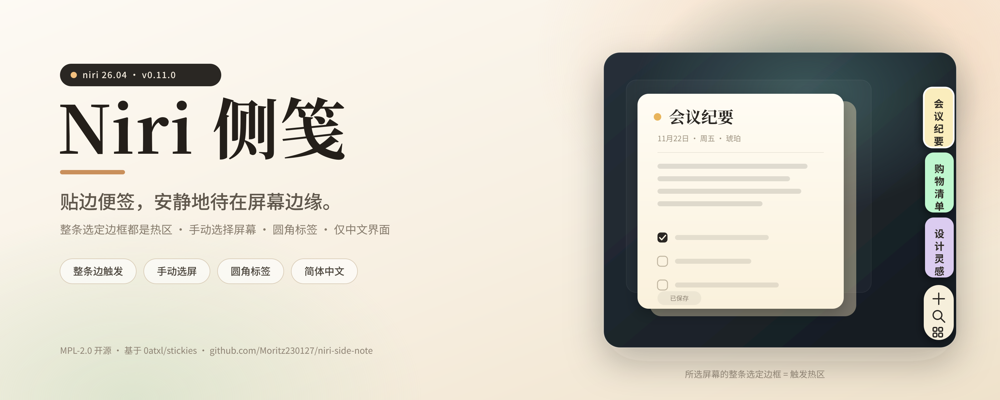

<div align="center">
  
</div>

<p align="center">
  <a href="https://github.com/Moritz230127/niri-side-note/releases/latest"></a>
  <a href="https://github.com/Moritz230127/niri-side-note/actions/workflows/ci.yml"></a>
  
  
  <a href="https://github.com/Moritz230127/rodriguez"></a>
</p>

<h1 align="center">Niri 侧笺</h1>
<p align="center"><strong>贴边便签，安静地待在屏幕边缘。</strong><br>
整条选定边框都是热区；鼠标靠近展开，点开即可写，离开自动收回。</p>

> 基于 [0atxl/stickies](https://github.com/0atxl/stickies) `0.10.3` 的非官方简体中文分支，当前版本 **v0.11.0-niri.2**，遵循 **MPL-2.0**。

---

## 一眼看懂


<p align="center"><sub>界面示意图 · Paper 主题 · 右侧贴边 · 圆角标签与便签面板</sub></p>

- **贴边即用**：便签标签常驻屏幕边缘，不占工作区、不打断当前窗口。
- **整条边框触发**：所选屏幕的整条选定边都是热区，不用瞄准某个点或线。
- **圆角标签**：简洁、圆角、便签自身颜色；当前打开的便签用白色描边区分。
- **手动选屏**：多屏环境下按 connector（`eDP-1`、`HDMI-A-1`…）选择贴边所在屏幕。
- **全中文**：界面、菜单、日期、颜色名与错误提示均为简体中文。
- **本地优先**：SQLite 存储，无账号、无遥测、离线可用。

---

## 功能

### 贴边与选屏

- 支持屏幕**上 / 下 / 左 / 右**四条边。
- 触发范围是**所选屏幕的整条选定边框**：贴边带覆盖整条边的长度，落在带内任意位置都会展开。
- **手动选择屏幕**：设置里按 GDK connector 选择，也可保留「自动」；选择立即生效并写入配置。
- 自动模式会保留当前屏幕，显示器列表顺序变化时不再跳屏。
- 收起态没有常驻按钮或图标；鼠标移开即收起。

### 标签

- 简洁圆角标签，便签色填充 + 细边 + 轻阴影。
- 当前打开的便签用白色描边区分，其余标签降低透明度，完整标题保留 tooltip。
- 标签固定长度，初始居中；数量增加后向两端生长，占满后自动重叠。
- 新建 / 搜索 / 全部便签合并为一个圆角工具胶囊。

### 编辑

- 标题 / 正文自动保存（停止输入 750 ms 后）。
- 纯文本便签与 `- [ ]` 清单，支持勾选。
- 标题 / 正文独立撤销重做，支持粗体、斜体、下划线、删除线。
- 全部便签窗口：搜索、排序、置顶、归档 / 恢复、软删除与撤销。
- 贴边打开、单独弹出、多个便签窗口。
- 自动收起可选：关闭 / 1 / 2 / 5 分钟；也可设为「始终打开」。

### 中文与外观

- 简体中文单语：设置、菜单、空状态、日期、CLI 描述、错误提示与颜色名称。
- 日期显示为 `11月22日` 形式。
- 主题：纸面（Paper）、轻快（Playful）、极简（Minimal，跟随系统深浅色）。
- 旧配置中的未知键会被忽略，升级不会因为遗留字段无法启动。

---

## 安装

### Arch Linux（推荐，rodriguez 仓库）

本分支由个人 pacman 仓库 `rodriguez` 分发，包名 `niri-side-note-bin`，依赖 `gtk4-layer-shell` 会一并安装。

```ini
# /etc/pacman.conf
[rodriguez]
SigLevel = Required DatabaseOptional
Server = https://github.com/Moritz230127/rodriguez/releases/download/rolling
```

首次使用需导入并本地签名仓库公钥：

```bash
curl -fsSL https://github.com/Moritz230127/rodriguez/releases/download/rolling/packages.asc -o /tmp/rodriguez.asc
sudo pacman-key --add /tmp/rodriguez.asc
sudo pacman-key --lsign-key 028A4747923154F7
sudo pacman -Syu
sudo pacman -S niri-side-note-bin
```

> 不要只跑 `pacman -Sy` 装单个包；Arch 上请始终使用 `pacman -Syu`，避免部分升级。

### 从源码构建

需要 Rust 1.92+、GTK 4、libadwaita 与 `gtk4-layer-shell`（Arch：`gtk4 libadwaita gtk4-layer-shell`）。

```bash
git clone https://github.com/Moritz230127/niri-side-note.git
cd niri-side-note
cargo build --release --locked
install -Dm755 target/release/stickies ~/.local/bin/niri-side-note
```

可选：安装桌面文件与图标，方便从启动器打开。

```bash
install -Dm644 packaging/niri-side-note.desktop ~/.local/share/applications/niri-side-note.desktop
install -Dm644 data/dev.stickies.Stickies.png \
  ~/.local/share/icons/hicolor/128x128/apps/dev.stickies.Stickies.png
```

> Cargo 包名与内部应用 ID 仍是 `stickies`，安装后的命令是 `niri-side-note`。

### 开机启动（niri）

应用内不管理自启。需要时在 niri 配置中加入：

```kdl
spawn-at-startup "niri-side-note"
```

---

## 使用

1. 把鼠标移到所选屏幕的贴边（默认右侧）边缘，标签会展开。
2. 点击标签标题打开便签；`+` 新建、`🔍` 搜索、`☰` 打开全部便签。
3. 全部便签右上角齿轮进入设置，可切换屏幕、贴边、主题、自动收起等。
4. 关闭便签：`Esc`、标题栏关闭按钮，或再次移开鼠标让贴边条收起。
5. 退出应用：设置 →「退出 Niri 侧笺」。

命令行（可绑定到 niri 快捷键）：

```bash
niri-side-note --new-note        # 新建便签
niri-side-note --search          # 搜索便签
niri-side-note --toggle-strip    # 展开 / 收起贴边条
niri-side-note --show-all-notes  # 打开全部便签
```

再次启动已在运行的实例时，会展开贴边条或呈现「全部便签」，不会静默无操作。

---

## 配置与数据

> 为兼容旧版笔记，配置与数据目录沿用 `stickies`。

- 配置：`~/.config/stickies/config.toml`
- 数据：`~/.local/share/stickies/notes.db`

常用配置项：

| 键 | 说明 | 默认 |
|---|---|---|
| `edge` | `left` / `right` / `top` / `bottom` | `right` |
| `monitor` | 屏幕 connector；缺省为自动 | 自动 |
| `marker_offset` | 沿边的位置，`0..1` | `0.5` |
| `edge_hover_enabled` | 悬停展开 | `true` |
| `theme` | `paper` / `playful` / `minimal` | `paper` |
| `appearance` | `system` / `light` / `dark` | `system` |
| `inactivity_seconds` | 自动收起秒数；`0` 表示始终打开 | `120` |
| `hide_in_fullscreen` | 全屏时隐藏贴边条 | `true` |
| `hide_in_dnd` | 勿扰时隐藏贴边条 | `true` |
| `reduced_motion` | 减少动画 | `false` |

`marker_offset` 的键名沿用旧版以兼容配置；`custom_marker_offset` 保存最近一次自定义位置。

---

## 构建与测试

```bash
cargo fmt --all -- --check
cargo clippy --locked --all-targets -- -D warnings -A deprecated
cargo test --locked
```

当前基线：54 个测试通过；23 个需要显示环境的测试标记为 ignored。

生成 rodriguez 仓库使用的便携发行包：

```bash
./packaging/package-portable.sh
# 产物：dist/portable/niri-side-note-<版本>-linux-x86_64.tar.gz
```

需要系统已安装 `gtk4-layer-shell`；脚本会构建 release 二进制、strip 并打包桌面文件、图标、文档与许可证。

---

## 与上游的关系

- 本项目是 [0atxl/stickies](https://github.com/0atxl/stickies) 的**非官方**简体中文分支，与上游无隶属关系。
- 本分支的主要差异：中文单语化、手动选屏、整边触发、圆角标签、按需映射的贴边面板，以及针对 niri 的键盘焦点 / 尺寸 / 退出稳定性修复。
- 上游版权归其贡献者所有；本分支的修改同样以 MPL-2.0 公开，完整对应源码见本仓库。
- 发布说明：[v0.11.0-niri.2](packaging/releases/v0.11.0-niri.2.md) · [全部版本](https://github.com/Moritz230127/niri-side-note/releases)

## 已知限制

- 贴边带厚度约 45px（略大于标签深度），暂未做成可配置项。
- 应用 ID 与数据目录沿用 `stickies`；与上游 Stickies 同时安装会共享单实例与数据，建议只保留一个。
- 屏幕列表在打开设置时枚举；运行中热插拔显示器后需重开设置。
- 系统深浅色切换没有实时监听，切换后可能需要重开窗口。
- 没有云同步、Markdown 导出与跨平台版本（Linux Wayland 专向）。

## 许可证

[MPL-2.0](LICENSE)。第三方字体与 `gtk4-layer-shell` 的许可证见 [NOTICE](NOTICE) 与 `share/licenses/niri-side-note/fonts/`。

---

<p align="center"><sub>用 niri 和一杯咖啡做的贴边便签 · Made for niri</sub></p>
