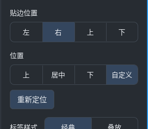

# Niri 侧笺（Niri Side Note）

贴边便签工具：便签标签常驻屏幕边缘，鼠标靠近时展开，点标题打开便签，离开后自动收回。

> 本项目是 [0atxl/stickies](https://github.com/0atxl/stickies) 的**非官方简体中文分支**，与上游项目无隶属关系。
> 基于上游 `0.10.3`，当前分支版本为 `v0.10.3-niri.1`，遵循 **MPL-2.0**。
> 产品名为「Niri 侧笺」；内部应用 ID 与数据目录仍沿用 `stickies`，以兼容已有笔记。




## 功能

### 贴边与标签

- 支持屏幕**上 / 下 / 左 / 右**四条边。
- 整条屏幕边缘都是展开热区，不再需要瞄准某个点或线。
- 标签固定长度，初始居中；数量增加后向两端生长，占满后自动重叠。
- 文档式标签外观：细便签色线、当前标签高亮背景、非当前标签降低透明度、完整标题 tooltip。
- 支持经典 / 叠放两种标签样式。
- 可选择贴边所在的显示器（按 GDK connector，例如 `HDMI-A-1`、`eDP-1`），配置会自动保存。
- 收起态没有常驻触发图标；鼠标移开即收起。

### 便签

- 本地 SQLite，无账号、无遥测、离线可用。
- 标题 / 正文自动保存（停止输入 750 ms 后）。
- 纯文本便签与 `- [ ]` 清单，支持勾选。
- 标题 / 正文独立撤销重做，支持富文本格式（粗体 / 斜体 / 下划线 / 删除线 / 字体 / 纸面）。
- 全部便签窗口：搜索、排序、置顶、归档 / 恢复、软删除与撤销。
- 贴边打开、单独弹出、多个便签窗口。
- 自动收起可选：关闭 / 1 分钟 / 2 分钟 / 5 分钟；可设“始终打开”。

### 中文单语

- 设置、菜单、空状态、日期、CLI 描述、错误提示均为简体中文。
- 日期显示为 `11月19日` 形式，不再出现英文月份。
- 旧配置中的未知键会被忽略，升级不会因为遗留字段无法启动。
- 应用内“开机自启”开关和相关后端代码已移除；开机启动交给 niri。

## 与上游的主要差异

- 中文单语化。
- 屏幕选择 GUI 与自适应整边热区。
- 文档式标签、固定长度 + 动态重叠、自定义位置记忆。
- 移除点/线触发器、可见便签数设置、应用内开机自启。
- 设置往返修复：切换标签布局 / 屏幕 / 自定义位置后能恢复原效果。

## 系统要求

- Linux Wayland，支持 `zwlr_layer_shell_v1` **v4+**。
- 已验证 / 目标环境：niri、Sway、Hyprland 等支持 Layer Shell 的合成器。
- **不支持 GNOME Wayland**（没有 Layer Shell）。
- GTK 4、libadwaita、gtk4-layer-shell。
- 中文需要系统 CJK 字体，例如 `noto-fonts-cjk`；缺失时中文会缺字形。
- Arch 打包产物为 `x86_64`。

## 安装

### Arch 包（个人源）

本分支由个人 pacman 源 `rodriguez` 分发：

```ini
[rodriguez]
SigLevel = Required DatabaseOptional
Server = https://github.com/Moritz230127/rodriguez/releases/download/rolling
```

```bash
sudo pacman -Syu
sudo pacman -S niri-side-note
```

安装后的命令是 `niri-side-note`，桌面文件为“Niri 侧笺”。

### 从源码构建

需要 Rust、GTK 4、libadwaita 和 `gtk4-layer-shell`：

```bash
cargo build --release --locked
install -Dm755 target/release/stickies ~/.local/bin/niri-side-note
```

> 上游包名也是 `stickies`。为避免覆盖上游安装，本分支的包名与命令名使用
> `niri-side-note`，源码里的 Cargo 包名与内部应用 ID 仍是 `stickies`。

### 开机启动（niri）

应用内不再管理开机自启。需要时在 niri 配置中加入：

```kdl
spawn-at-startup "/usr/bin/niri-side-note"
```

从源码安装到用户目录时：

```kdl
spawn-at-startup "/home/你的用户名/.local/bin/niri-side-note"
```

## 使用

1. 把鼠标移到所选屏幕的贴边（默认右侧）边缘。
2. 标签出现后点击标题打开便签。
3. 标签条上的 `+` 新建便签，`🔍` 搜索，`☰` 打开全部便签。
4. 全部便签右上角齿轮进入设置。
5. 设置 → 屏幕：选择 HDMI / eDP；设置 → 贴边位置：上 / 下 / 左 / 右。
6. 设置 → 位置：上 / 居中 / 下 / 自定义。自定义值会记住，切换后可以点「自定义」恢复。
7. 设置 → 标签样式：经典 / 叠放。

## 配置与数据

> 为兼容旧版笔记，配置和数据目录没有随产品名改动。

- 配置：`~/.config/stickies/config.toml`
- 数据：`~/.local/share/stickies/notes.db`
- 配置中的 `monitor` 使用显示器 connector 名称；删除该键表示自动选择第一块可用屏幕。
- `marker_offset` 保留为沿边缘位置（0..1），`custom_marker_offset` 保存最近一次非预设位置。
- `hide_in_fullscreen = true` 时，全屏窗口会隐藏贴边条；想全屏时也能用可改为 `false`。
- 应用内开机自启已移除；旧配置的 `launch_at_login` 会被忽略。

## 开发与测试

```bash
cargo test --locked
cargo clippy --locked --all-targets -- -D warnings -A deprecated
cargo fmt --all -- --check
```

当前基线：54 个测试通过，23 个需要显示环境的测试忽略。

## 已知限制

- 鼠标 hover 展开与重叠标签坐标命中未在无输入设备的 headless 测试环境中自动化，建议在真机确认。
- 设置里的屏幕列表在打开设置时枚举；运行中热插拔显示器后需重开设置。
- 系统深浅色变化没有实时监听；切换系统主题后可能需要重开窗口。
- 单条便签字体 / 纸面从“跟随默认”改成显式值后，不会再跟随主题默认。
- 全屏窗口会按 `hide_in_fullscreen` 隐藏贴边条。
- 没有云同步、Markdown 导出和跨平台版本。

## 许可证与致谢

本项目是 [0atxl/stickies](https://github.com/0atxl/stickies) 的非官方分支，沿用上游的 **MPL-2.0** 许可证；详见 [LICENSE](LICENSE)。
上游版权归其贡献者所有。本分支的修改、简体中文本地化与打包脚本同样以 MPL-2.0 公开；完整对应源码见本仓库。
